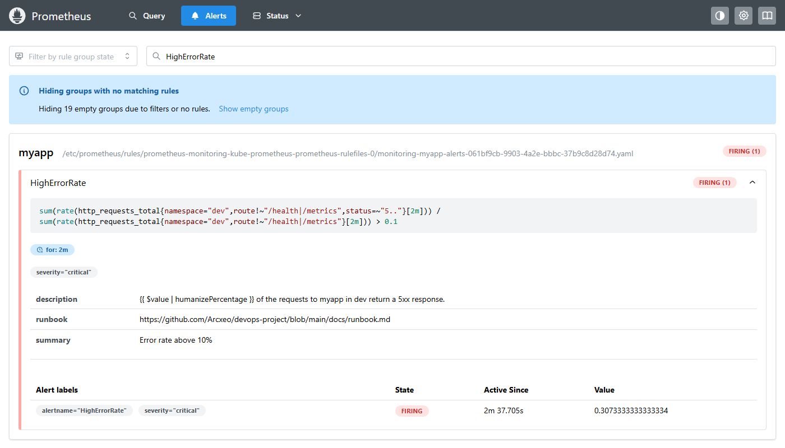
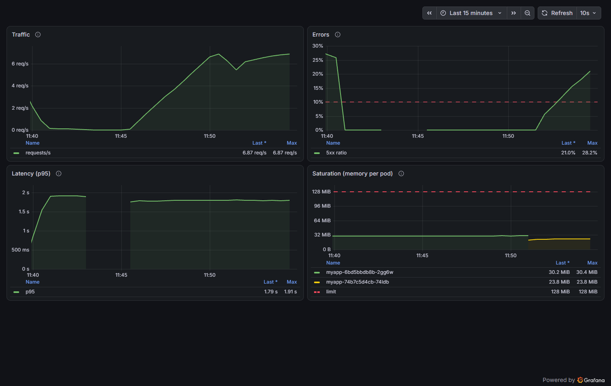

# DevOps Labs

## Group members

- Ali Belhassen
- Arnaud Van Eeckhoven
- Nicolas Papleux
- Romain Dangin

We used AI as a guide during the labs.

## Session 1: Git, CI/CD and Docker

### Part 1 - Git repository and branching workflow

#### 1. Why forbid direct pushes to `main`?

Pull requests give someone else a chance to review the change and let CI run before it reaches `main`. A direct push can put a broken commit on the shared branch straight away.

### Part 2 - Containerization

Commands used to build and run the application:

```sh
docker build -t myapp:0.1 .
docker run -d -p 3000:3000 --name myapp myapp:0.1
curl http://localhost:3000/health
docker logs myapp
docker exec -it myapp sh
```

We also built the application with the standard Node image to compare sizes:

```sh
docker build --build-arg NODE_IMAGE=node:24 -t myapp:0.1-standard .
docker image ls myapp
```

Cleanup command:

```sh
docker rm -f myapp
```

#### 2. What is the difference between an image and a container?

The image contains the application, its dependencies and the default command. A container is an instance of that image, with its own processes and a writable layer. We can start several containers from the same image.

#### 3. Compare the size of your image with a non-slim base image. What do you observe?

Our Alpine build was about 252 MB. The build with `node:24` was 1.64 GB, roughly six and a half times larger. The standard base includes more system packages.

### Part 3 - CI pipeline

Our GitHub Actions workflow runs `npm ci`, the linter, the tests and the Docker build on each Pull Request. A push to `main` also publishes the image to GitHub Container Registry.

#### 4. Why tag the image with the commit SHA rather than `latest`?

The commit SHA tells us which revision an image was built from. If something breaks, we can go back to that commit and its CI run. `latest` can point at a different build by then.

#### 5. What does "fail fast" mean in a pipeline?

Run the quick checks first and stop when one fails. If the tests are red, we can skip the Docker build and fix the tests.

## Session 2: Kubernetes, Multi-environment Deployment and Audit

### Part 1 - Local cluster setup

We created a local cluster named `devops-lab` with kind. We checked that the control-plane node was ready and that the three namespaces were active in the `kind-devops-lab` context.

Useful checks:

```sh
kind get clusters
kubectl cluster-info --context kind-devops-lab
kubectl get nodes --context kind-devops-lab
kubectl get namespace dev staging prod --context kind-devops-lab
```

#### 1. What is the role of a namespace? Does it provide strong security isolation by itself?

We used `dev`, `staging` and `prod` to keep each environment's Pods and Services separate. They still share a cluster, and Pods can usually reach each other under the default network setup. RBAC controls API access and NetworkPolicies can restrict traffic between workloads.

### Part 2 - First deployment

The Kubernetes manifests are in `k8s/base/`. The Deployment starts three copies of `myapp:0.1`, and the Service exposes them on port 80 inside the cluster.

Commands used for the deployment:

```sh
kind load docker-image myapp:0.1 --name devops-lab
kubectl apply -f k8s/base/ -n dev
kubectl get all -n dev
kubectl port-forward svc/myapp 8080:80 -n dev
curl http://localhost:8080/health
```

#### 2. Why does Kubernetes recreate the deleted Pod? Which component is responsible?

The Deployment asks for three replicas. After we delete a Pod, the ReplicaSet controller sees only two and starts a replacement. The replacement gets its own name.

### Part 3 - Probes, resources and configuration

The Deployment now checks `/health` with readiness and liveness probes. It also defines CPU and memory requests and limits. `APP_ENV` comes from `myapp-config`, while the fake `API_KEY` comes from `myapp-secret`.

#### 3. What is the difference between a readiness and a liveness probe? What happens to traffic when readiness fails?

Readiness controls whether the Pod receives traffic from the Service. If the check fails, the Pod stays up but stops receiving that traffic. Repeated liveness failures cause the kubelet to restart the container.

#### 4. Is a Kubernetes Secret encrypted by default? How would you improve this?

Values in the `data` field are base64-encoded, which anyone who can read them can decode. We would enable encryption at rest for etcd, restrict access with RBAC and keep real credentials in a secret manager.

### Part 4 - Multiple environments with Kustomize

The files in `k8s/base/` contain the common configuration. Each folder in `k8s/overlays/` changes the namespace, the `env` label, `APP_ENV` and the replica count. We use one replica in `dev`, three in `staging` and five in `prod`.

Commands used to preview and deploy the overlays:

```sh
kubectl kustomize k8s/overlays/dev
kubectl kustomize k8s/overlays/staging
kubectl kustomize k8s/overlays/prod
kubectl apply -k k8s/overlays/dev
kubectl apply -k k8s/overlays/staging
kubectl apply -k k8s/overlays/prod
kubectl get deployment -A -l app=myapp
```

#### 5. How does this pattern help with hybrid or multi-cloud deployments? What would differ between a real on-prem cluster and a cloud cluster?

We can share the Deployment and Service and keep each environment's differences in its overlay. A cloud overlay might use a managed load balancer and storage class. An on-prem overlay would use the ingress and storage available in that cluster.

### Part 5 - Rolling update and rollback

For version `0.2`, `/health` returns `OK v0.2`. We built the new image, loaded it into kind and changed the `dev` overlay from `myapp:0.1` to `myapp:0.2`. Requests continued to succeed while Kubernetes replaced the Pod.

We then applied the nonexistent tag `myapp:broken` on purpose. The new Pod stayed in `ImagePullBackOff`, while the previous `0.2` Pod continued serving traffic. `kubectl rollout undo` restored the Deployment.

Commands used during the test:

```sh
docker build -t myapp:0.2 .
kind load docker-image myapp:0.2 --name devops-lab
kubectl apply -k k8s/overlays/dev
kubectl rollout status deployment/myapp -n dev
kubectl rollout history deployment/myapp -n dev
kubectl rollout undo deployment/myapp -n dev
```

#### 6. Why did the broken rollout not take down the application?

The new Pod could never pull `myapp:broken`, so it never became ready. The rolling update kept the old `0.2` Pod serving requests. We still had to run `kubectl rollout undo` to restore the Deployment.

### Part 6 - Audit and traceability

The `prod` Deployment has annotations for the Git commit, the GitHub Actions run, the owner and the ticket. The RBAC manifests in `k8s/rbac/` create a `viewer` ServiceAccount that can only read Pods in `dev`.

```sh
kubectl apply -k k8s/overlays/prod
kubectl get events -n prod --sort-by=.metadata.creationTimestamp
kubectl describe deployment myapp -n prod
kubectl apply -k k8s/rbac
kubectl auth can-i list pods -n dev --as=system:serviceaccount:dev:viewer
kubectl auth can-i delete pods -n dev --as=system:serviceaccount:dev:viewer
```

Observed RBAC results:

```text
list pods:    yes
get pods:     yes
delete pods:  no
list secrets: no
```

The production trace used in this lab is:

```text
Pod -> ReplicaSet -> Deployment
commit: 73637f31c7329ec4d91521f7cfd72e8a838f2771
pipeline: https://github.com/Arcxeo/devops-project/actions/runs/44121519990
owner: team-a
ticket: OPS-123
```

#### 7. Starting from a Pod running in production, how can you find the commit, the reviewer and the pipeline run that produced it?

Follow `ownerReferences` from the Pod to its ReplicaSet and then to the Deployment. The Deployment annotations give us the commit and the Actions run. From the commit on GitHub, we can open the PR and look up who reviewed it.

#### 8. Why is manual `kubectl edit` in production a traceability risk?

`kubectl edit` updates the cluster immediately, so the diff never goes through Git, review or CI. The next deployment can overwrite it, and the team may struggle to explain when or why it changed.

## Session 3: Terraform, Environments and Ephemeral Previews

See the [Terraform lab notes](infra/README.md) for the commands and test output.

### Part 1 - First Terraform Configuration

#### 1. What did Terraform propose after you deleted the container by hand? What is this situation called?

After we deleted `tf-web`, Terraform's next plan proposed creating it again on port `8082`. The configuration still declared the container, but Docker no longer had it. That's drift.

#### 2. Why should the state file never be committed to Git?

State can include passwords, internal addresses and resource IDs. If it gets into Git, removing the file in a later commit leaves the earlier copy in history. A shared backend can restrict access, encrypt state and lock it during updates.

### Part 2 - Variables, Outputs and Modules

#### 3. What are the advantages of one folder and one state per environment compared to workspaces?

For this lab we ran Terraform in `infra/envs/dev` or `infra/envs/staging`, so the command itself made the target clear. Each directory can have its own variables, backend and permissions. With CLI workspaces, both environments share a configuration and the selected workspace decides which state Terraform opens.

### Part 3 - State Management

#### 4. Why is a remote backend with locking essential for a team? Which problems does it prevent?

Everyone needs to work from the same state. The lock stops two operations from writing it at once and losing each other's changes. We used a shared local path for the exercise. In a team we'd use a remote backend with locking and version history.

#### 5. What information in a state file can be sensitive?

Passwords, API tokens and connection strings can end up in state, along with private addresses and resource IDs. Terraform can hide a sensitive value in the terminal while still storing it in state or a saved plan.

### Part 4 - Ephemeral Environment per Pull Request

#### 6. What could go wrong if the preview environment is never destroyed? List three mitigations.

An old preview keeps using cluster resources and can leave an outdated build reachable. We'd handle it in three ways.

1. Destroy the preview when the PR closes or merges.
2. Give it an expiry date and schedule a job to clean up expired namespaces.
3. Assign an owner and use resource quotas to limit what each preview can consume.

### Part 5 - Terraform in CI with Security Scanning

#### 7. Why run plan on a Pull Request but apply only after merge?

A plan lets reviewers see what Terraform would add, change or delete before anything happens to the shared environment. An apply after merge uses the approved revision and can go through the deployment environment's approval rules.

#### 8. Why should a CI pipeline use short-lived credentials (OIDC) rather than long-lived access keys?

With OIDC, a job exchanges its identity for credentials that expire. We can limit which repository, branch or environment can request them and what they can do. There is no permanent access key to store in the repository's secrets.

## Session 4: Observability, Alerting and Incident Response

### Part 1 - Instrument the Application

The application now exposes Prometheus metrics on `/metrics` and writes one JSON log line per request to stdout. We added two test endpoints: `/slow` waits for a random time up to 2 seconds, and `/error` returns HTTP 500 about 30% of the time.

Commands used to test and build it:

```sh
npm ci
node app.js
curl localhost:3000/slow
curl localhost:3000/error
curl localhost:3000/metrics
docker build -t myapp:$(git rev-parse HEAD) .
```

Over 200 local calls to `/error`, we got 70 HTTP 500 responses (35%). The counters in `/metrics` matched the calls:

```text
http_requests_total{method="GET",route="/slow",status="200"} 8
http_requests_total{method="GET",route="/error",status="500"} 70
http_requests_total{method="GET",route="/error",status="200"} 130
```

#### 1. Why is it a problem to use a user ID or a full URL containing IDs as a metric label?

Prometheus stores one time series per combination of label values, so each new ID creates more series, multiplied by the number of buckets for a histogram. Memory use grows and queries slow down. We use the Express route pattern as the label, with `unmatched` for unknown paths, and keep the real path in the logs.

#### 2. Why log to stdout in JSON rather than to a file in plain text?

A file inside the container is lost with the Pod. With stdout, Kubernetes collects the output, `kubectl logs` can show it and an agent can send it to a central store. JSON fields such as `status` or `level` can be filtered directly, without parsing free text.

### Part 2 - Deploy the Monitoring Stack

We installed the `kube-prometheus-stack` Helm chart in the `monitoring` namespace of the `devops-lab` kind cluster. All six Pods became ready: Prometheus, Alertmanager, Grafana, the operator, kube-state-metrics and the node exporter.

```sh
helm repo add prometheus-community https://prometheus-community.github.io/helm-charts
helm repo update
kubectl create namespace monitoring
helm install monitoring prometheus-community/kube-prometheus-stack -n monitoring
kubectl get pods -n monitoring
kubectl get secret monitoring-grafana -n monitoring -o jsonpath='{.data.admin-password}' | base64 -d
kubectl port-forward -n monitoring svc/monitoring-grafana 3001:80
kubectl port-forward -n monitoring svc/monitoring-kube-prometheus-prometheus 9090:9090
```

The Grafana password comes from the `monitoring-grafana` Secret, for the user `admin`. Grafana comes with 29 dashboards and Prometheus as a data source.

The Prometheus `Targets` page showed 14 targets up and 4 down:

```text
down  kube-controller-manager  172.22.0.2:10257  connection refused
down  kube-etcd                172.22.0.2:2381   connection refused
down  kube-proxy               172.22.0.2:10249  connection refused
down  kube-scheduler           172.22.0.2:10259  connection refused
```

By default, these components serve their metrics on `127.0.0.1` inside the node, so Prometheus can't reach them from its Pod. They work normally, but the related alerts, such as `TargetDown`, are noise on this cluster.

### Part 3 - Scrape Your Application

The `ServiceMonitor` is in `monitoring/servicemonitor.yaml`. The Service already had a port named `http` and the label `app: myapp`, so we left it unchanged. We set the `dev` overlay to the instrumented image, tagged with its commit SHA.

```sh
kind load docker-image myapp:ae4469be4ebbd63d6044592d17f19d9bc9db4c08 --name devops-lab
kubectl apply -k k8s/overlays/dev
kubectl apply -f monitoring/servicemonitor.yaml
kubectl port-forward -n dev svc/myapp 8080:80
```

The target `serviceMonitor/monitoring/myapp/0` is `UP` in Prometheus. We ran the traffic loop for about two minutes, which made 73 iterations, then queried `http_requests_total`:

```text
route="/health"    status="200"  81
route="/metrics"   status="200"  16
route="unmatched"  status="404"  73
route="/slow"      status="200"  73
route="/error"     status="200"  45
route="/error"     status="500"  28
```

The loop also calls `/`, which the application doesn't define, hence the 404 responses. The `/health` requests come from the Kubernetes probes and the `/metrics` requests from Prometheus.

#### 3. The target does not appear. List three things you would check.

1. The `ServiceMonitor` has the label `release: monitoring`. The Prometheus from this chart ignores the ones without it.
2. `namespaceSelector` and `selector.matchLabels` match the namespace and the labels of the Service itself, not those of the Pods.
3. The `port` in the `ServiceMonitor` matches the port name in the Service (`http`), and `kubectl get endpointslices -n dev` lists a Pod behind the Service.

### Part 4 - PromQL and Dashboard

The dashboard has one panel per golden signal. Its export is in `monitoring/dashboards/myapp-golden-signals.json` and can be loaded in Grafana with `Dashboards > New > Import`.

```promql
# Traffic
sum(rate(http_requests_total{namespace="dev", route!~"/health|/metrics"}[5m]))

# Error ratio
(sum(rate(http_requests_total{namespace="dev", route!~"/health|/metrics", status=~"5.."}[5m])) or vector(0))
  / sum(rate(http_requests_total{namespace="dev", route!~"/health|/metrics"}[5m]))

# p95 latency
histogram_quantile(0.95,
  sum(rate(http_request_duration_seconds_bucket{namespace="dev", route!~"/health|/metrics"}[5m])) by (le))

# Memory per pod
sum(container_memory_working_set_bytes{namespace="dev", container!=""}) by (pod)
```

We made three changes to the queries from the lab:

- We excluded `/health` and `/metrics`, since the probes and the scrapes would lower the error ratio and the latency.
- We added `or vector(0)`, so that the error panel shows 0% instead of no data when there are no 5xx responses.
- We added `container!=""` to the memory query. Without it, the total of the Pod is added to that of its containers: we got 45.6 MB instead of 22.7 MB.

With the traffic loop running, the error ratio was about 11% and the p95 latency 1.7 s. The Pod used about 21 MiB of memory, for a limit of 128 MiB.

#### 4. Why is the 95th percentile more informative than the average latency?

The average mixes fast and slow requests, so a few very slow ones can go unnoticed. The p95 is the duration that 95% of requests stay under, so it shows what the slowest 5% of users experience. We measured an average of 0.34 s and a p95 of 1.7 s: `/` and `/error` answer in a few milliseconds and pull the average down, while the p95 shows the delay of `/slow`.

### Part 5 - Alerting

The `HighErrorRate` rule is in `monitoring/prometheusrule.yaml`, and its runbook in [docs/runbook.md](docs/runbook.md). The rule uses the same filters as the Errors panel, so the dashed line of the dashboard shows the alert threshold.

```sh
kubectl apply -f monitoring/prometheusrule.yaml
kubectl port-forward -n dev svc/myapp 8085:80
while true; do curl -s -o /dev/null localhost:8085/error; done
```

We sent traffic without errors first, then called only `/error`. The alert went through these states (UTC):

```text
10:30:35  inactive   traffic without errors
10:32:22             start of the calls to /error
10:33:04  pending    error ratio above 10%
10:35:04  firing     still above 10% after 2 minutes
10:35:54             end of the calls to /error
10:38:34  inactive   resolved
```

The error ratio was 30.7% while the alert was firing. Alertmanager received the alert, but no notification channel is configured.



The loop from Part 3 gives an error ratio close to 10%, because a third of its calls go to `/error`. It can trigger the alert on its own.

#### 5. What is alert fatigue and how do the `for:` clause and severity labels help?

Alert fatigue is when a team gets so many alerts, many of them useless, that it starts ignoring them and can miss a real one. With `for: 2m`, a short spike stays `pending` and notifies no one. The `severity` label lets Alertmanager page someone for `critical` alerts and send the `warning` ones to a chat channel or a ticket. Our cluster shows the problem: the alerts on the kind components that Prometheus can't reach are always firing.

### Part 6 - Incident Simulation and Postmortem

The incident was simulated with Claude Code, which played both the saboteur and the responder. The faulty image `myapp:0.4` adds a 1-second timeout to `/slow`, so about half of the calls to this route return HTTP 503, while `/health` keeps answering 200. The full timeline is in [docs/postmortem.md](docs/postmortem.md).

```sh
# saboteur
kubectl set image deployment/myapp myapp=myapp:0.4 -n dev
# responder
kubectl rollout history deployment/myapp -n dev
kubectl logs -n dev -l app=myapp --tail=200
kubectl rollout undo deployment/myapp -n dev
```

```text
10:50:29  deployment of myapp:0.4
10:52:04  HighErrorRate pending
10:54:04  HighErrorRate firing, 26% of 5xx responses
10:55:06  rollback
10:57:38  alert resolved
```



We also found that the application ignores `SIGTERM`: a replaced Pod keeps serving its open connections until Kubernetes kills it 30 seconds later. It should be fixed.

#### 6. Why mitigate before finding the root cause?

Users are affected as long as the incident lasts, and finding the cause can take hours. A rollback took us 7 seconds and only required knowing that the errors started after a deployment. The metrics and logs are still there afterwards to investigate without pressure.

#### 7. Why must a postmortem be blameless? Give an example of a blameless rewording of "Alex deployed a bad version".

If people fear being blamed, they hide details, and the team can't fix what allowed the incident. A person's mistake is usually possible because of a gap in the process. Instead of "Alex deployed a bad version", we would write: "A version with a 1-second timeout on `/slow` was deployed to `dev`. No test or smoke test covered this route, so the pipeline could not detect the problem."

#### 8. Propose two concrete changes to the pipeline from Sessions 1 to 3 that would have prevented or limited this incident.

1. Smoke test: after the deployment to `dev`, the pipeline calls `/slow` 20 times and rolls back if any response is a 5xx. With half of the calls failing, it would have caught this version within seconds.
2. Canary release: the new version first receives a small share of the traffic, for example 10%, and the rollout stops if its error ratio is above the threshold. About 3% of the requests would have failed instead of 25%. A canary needs more than one replica and a tool such as Argo Rollouts.
