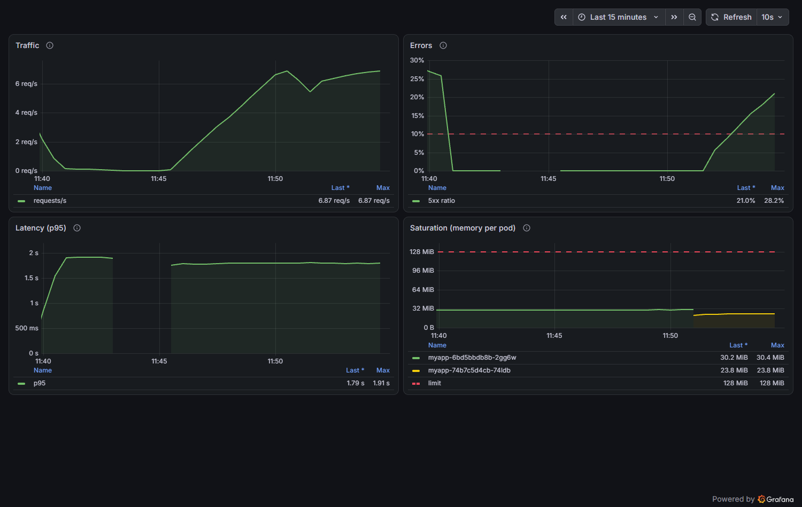
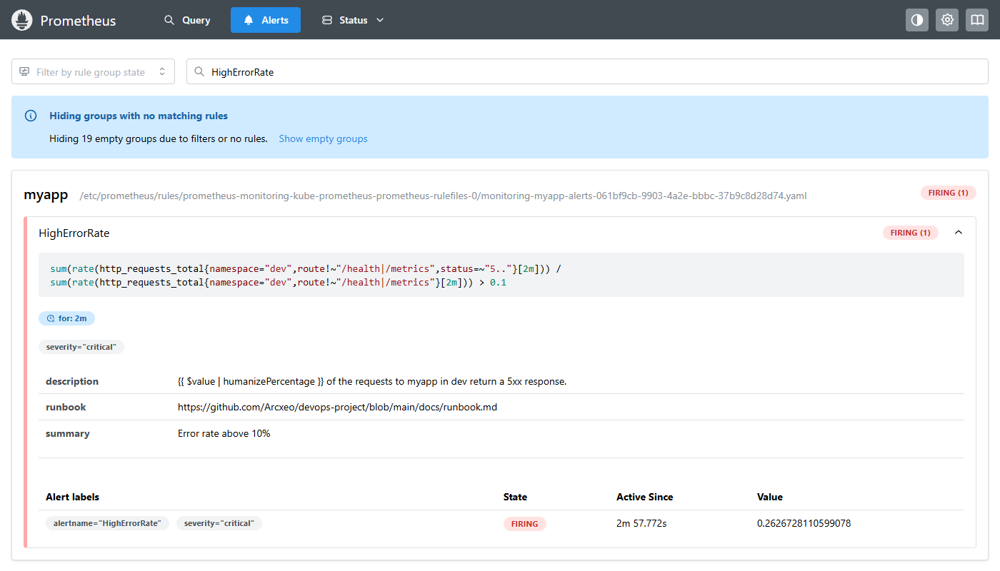

# Postmortem: HTTP 503 responses on /slow after the deployment of myapp 0.4

This incident was an exercise on the local kind cluster, on 2026-11-24. It was simulated with Claude Code, which played both the saboteur and the responder. The measurements are real, but the responder knew about the fault, so the diagnosis time is not representative.

## Summary and impact

Version `0.4` of `myapp` was deployed to `dev` with a 1-second timeout on `/slow`, a route that normally takes up to 2 seconds. Requests over the limit received HTTP 503.

- Duration: about 4 min 40 s, from the first errors (around 10:51:06) to the end of the faulty Pod (around 10:55:43).
- Failed requests: at least 494 HTTP 503 responses out of 1945 requests to the faulty Pod (25%), and 51% of the requests to `/slow`. Prometheus did not scrape the faulty Pod during its last 30 seconds, so the real number is higher.
- Other routes were not affected. `/health` kept answering 200.
- Deployment to alert: 3 min 35 s. Alert to rollback: 1 min 2 s.

## Timeline (UTC)

| Time | Event |
|---|---|
| 10:45:19 | Traffic starts on `/` and `/slow`. No 5xx responses |
| 10:50:29 | `kubectl set image` deploys `myapp:0.4` to `dev` |
| 10:50:36 | Rollout complete, the Pod is ready |
| 10:51:06 | The previous Pod is killed after its 30 s grace period. Clients move to the new Pod |
| 10:51:30 | First HTTP 503 visible in Prometheus |
| 10:52:04 | `HighErrorRate` is `pending` |
| 10:54:04 | `HighErrorRate` is `firing` |
| 10:54:41 | The responder sees the alert and opens the dashboard |
| 10:55:04 | Prometheus shows that all the 5xx come from `/slow` on one Pod |
| 10:55:05 | The Pod runs `myapp:0.4`, deployed at 10:50:29 |
| 10:55:06 | `kubectl rollout undo` |
| 10:55:13 | Rollback complete, the new Pod runs the previous image |
| 10:55:43 | The faulty Pod is killed after its 30 s grace period |
| 10:57:38 | `HighErrorRate` is inactive, the error ratio is back to 0 |

## Root cause and contributing factors

Root cause: version `0.4` added a 1-second timeout to `/slow`, while the route waits for a random time up to 2 seconds. About half of the requests exceeded the limit and received HTTP 503.

Contributing factors:

- No test covers `/slow`, so the CI could not detect the change in behaviour.
- The probes only call `/health`, which kept working. Kubernetes considered the rollout successful.
- The deployment was made by hand with `kubectl set image`, outside Git, the review and the pipeline. The tag `0.4` does not point to a commit, and the rollout history has no change cause.
- `dev` runs one replica, so the faulty version received all the traffic at once.
- The alert needs an error ratio above 10% over a 2-minute window, then 2 more minutes of `for:`.
- The application does not handle `SIGTERM`. After each rollout, the old Pod keeps serving open connections until it is killed 30 seconds later, which also delayed the effect of the rollback.

## What went well / what went poorly

What went well:

- The alert fired without human action, and the dashboard showed the increase in errors.
- The `route` and `pod` labels led directly to the faulty route and Pod.
- The rollback took 7 seconds and worked the first time, following the runbook.

What went poorly:

- Detection took more than 3 minutes, and no notification is sent: someone has to look at Prometheus.
- The p95 latency did not change, because the timeout hid the slowest requests. The Latency panel alone would not have shown the incident.
- 8 client requests failed with a network error when the old Pods were killed, 4 after the deployment and 4 after the rollback.

## Action items (owner, deadline)

| Action | Owner | Deadline |
|---|---|---|
| Add tests for `/slow` and `/error` to the CI | To be assigned | 2026-12-01 |
| Handle `SIGTERM`: close the server and finish the current requests | To be assigned | 2026-12-01 |
| Run a smoke test on `/slow` after each deployment, with an automatic rollback | To be assigned | 2026-12-08 |
| Deploy only through the pipeline, with commit SHA tags | To be assigned | 2026-12-08 |
| Send the critical alerts from Alertmanager to a chat channel | To be assigned | 2026-12-08 |
| Use a canary release to limit the traffic sent to a new version | To be assigned | 2026-12-15 |
